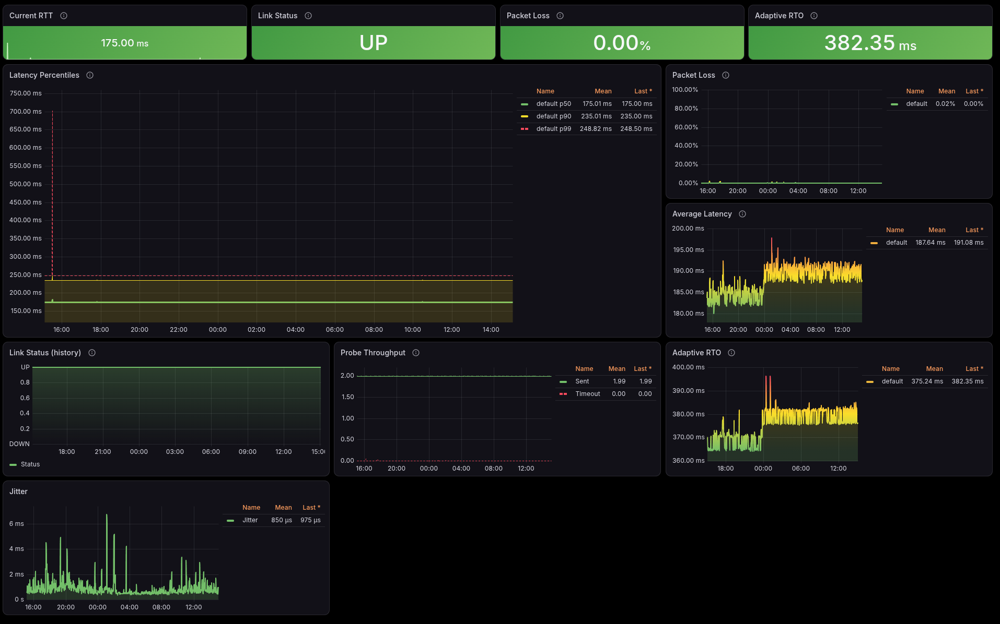

# Grafana Alloy Scraping

The example below scrapes the metrics endpoint, keeps only `link_*`
metrics (dropping `go_*`, `process_*`, and the Prometheus client's own
internals to save remote-write bandwidth and storage), and forwards the
result to a `prometheus.remote_write` component.

Add your own `prometheus.remote_write "default"` block (endpoint URL,
credentials) — it is intentionally not included here. If the remote
write component has a different name, update the
`prometheus.remote_write.default.receiver` reference below.

```river
prometheus.scrape "link_ping" {
 targets = [{
  "__address__" = "localhost:2112",
 }]
 metrics_path    = "/metrics"
 scrape_interval = "1m"
 scrape_timeout  = "10s"
 forward_to      = [prometheus.relabel.link_ping_keep.receiver]
}

prometheus.relabel "link_ping_keep" {
 rule {
  source_labels = ["__name__"]
  regex         = "link_.*"
  action        = "keep"
 }
 forward_to = [prometheus.remote_write.default.receiver]
}
```

If the agent and the prober run on different hosts, replace
`localhost:2112` with the prober's address. With metrics basic auth
enabled, add a `basic_auth` block to the scrape targets instead:

```river
prometheus.scrape "link_ping" {
 targets = [{
  "__address__" = "10.0.0.5:2112",
 }]
 ...
 basic_auth {
  username = "monitoring"
  password = "secret"
 }
}
```

## Grafana Dashboard

Prebuilt dashboard at [grafana-dashboard.json](../grafana-dashboard.json).
It uses the Grafana v2 dashboard resource format
(`dashboard.grafana.app/v2`) and needs a Grafana version that supports it;
it also has a `source` variable for filtering panels per site.

Panels: link status, packet loss, RTT percentiles / average / current, adaptive RTO, jitter, probe throughput, plus the newer signals — smoothed RTT (SRTT), path MTU (DF-probed), DF probe loss, corruption % (with `-payload`) and send errors (local fault vs network loss). A **Server & prober health** section covers probes in flight, server probes received / dropped by reason / echo errors, clock skew, prober internal errors and metrics auth failures. `link_up` transitions are annotated on every panel and itemized with timestamps in the Link State Changes table. The `source` variable filters the per-site panels, so one dashboard serves the whole fleet (the global metrics-auth-failure panel is deliberately unfiltered).

[](../.docs/screenshot01.png)
